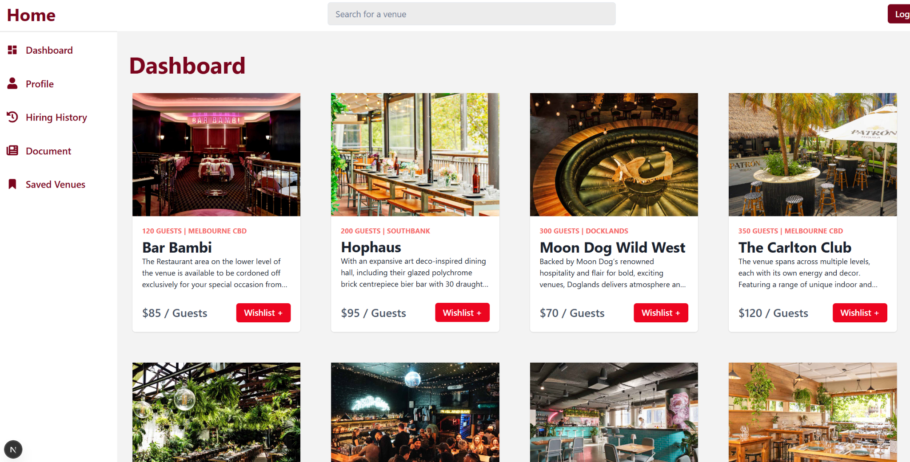
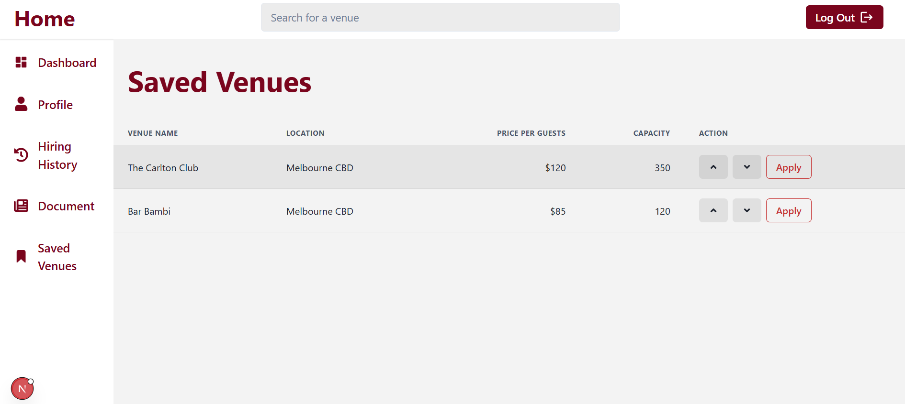
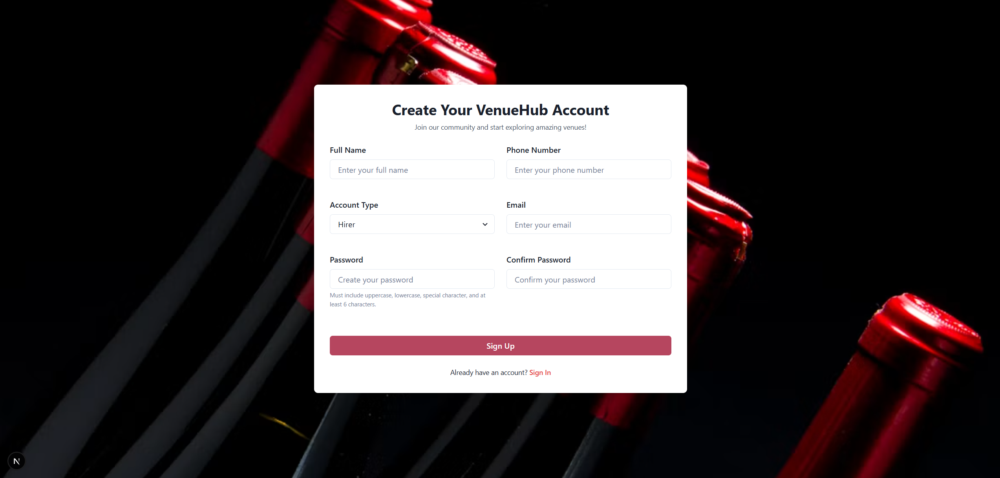
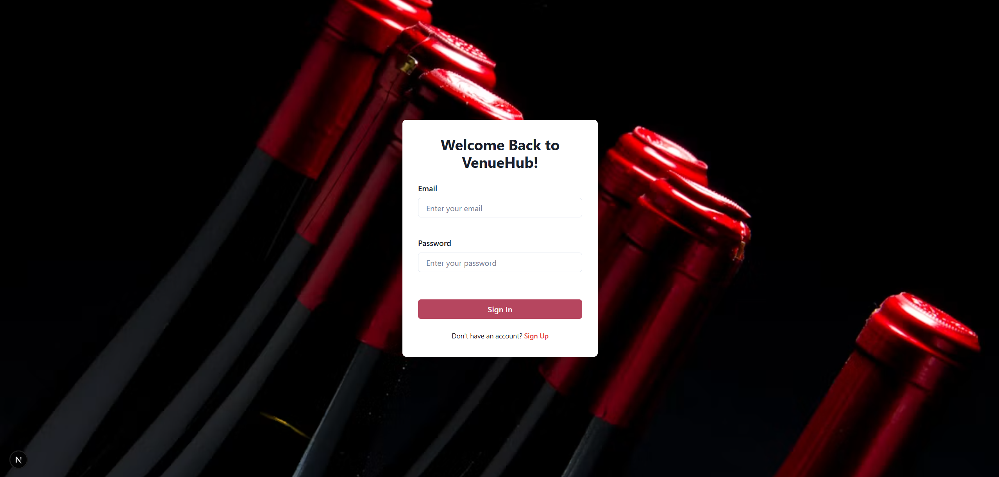

# Venue Booking Platform 🏛️

A full-stack web application that connects **venue hirers** with **venue vendors**, allowing users to discover venues, manage listings, handle bookings and interact with the platform through different role-based experiences.

This project was originally developed as a **team project at RMIT University during Semester 1, 2026** for the **Full Stack Development** course.

---

## 🔎 Overview

The platform was designed around two main user groups:

- **Hirers** looking for venues for events
- **Vendors** managing and advertising their venues

The project also included a separate **admin interface and backend** for administrative functionality.

The application was split into four main areas:

```text
backend/          Main backend API
frontend/         Main user-facing frontend
admin-backend/    Admin backend
admin-frontend/   Admin interface
```

## ✨ Features

### Hirer Features

* Create an account and log in
* Browse available venues
* View venue information
* Manage user profile
* Submit ratings and reviews

### Vendor Features

* Create and manage a vendor account
* Manage vendor profile information
* Create venue listings
* Edit existing venue information
* Delete venue listings
* View vendor-related platform information and analytics

### Admin Features

* Separate admin interface
* Administrative venue management
* GraphQL-based backend functionality
* Admin-specific testing and API operations

## 🛠️ Tech Stack

### Frontend

* React
* TypeScript
* HTML
* CSS

### Backend

* Node.js
* Express
* TypeScript
* TypeORM
* REST APIs
* GraphQL

### Database

* Microsoft SQL Server

### Testing

* Jest
* ts-jest
* Supertest
* SQLite

### Development Tools

* Git
* GitHub
* npm


## 👥 Team

Developed collaboratively by:

* **Jean Rogers**
* **Linh Le**

RMIT University  
Full Stack Development — Semester 1, 2026

## 👩‍💻 My Contributions

My main contributions focused on authentication, vendor functionality and connecting the frontend with the backend.

I worked on:
- Signup and login flows
- User authentication functionality
- Vendor profiles and vendor-facing pages
- Venue creation, editing and deletion
- Frontend and backend API integration
- Backend functionality using Express, TypeORM and SQL Server
- Unit and API testing
- Debugging and integration work
- Collaborative development using Git and GitHub
  
A large part of the project involved making sure independently developed pieces worked properly together, especially across the frontend and backend.

> This was a collaborative team project. The features above describe my main areas of contribution rather than the entire application being developed solely by me.

## 🗂️ Project Structure

```text
venue-booking-platform/
├── frontend/
│   └── Main React frontend
│
├── backend/
│   └── Main Express and TypeORM backend
│
├── admin-frontend/
│   └── Admin-facing frontend
│
├── admin-backend/
│   └── Admin backend and GraphQL functionality
│
└── README.md
```

## 📦 Project Availability

The original hosted database used during development is no longer available, so the full application cannot currently be reproduced in its original state without additional database setup and configuration.
The source code, project structure and recovered screenshots are preserved here for portfolio and review purposes.
The backend projects still include .env.example files showing the database configuration that was originally required.

## 📸 Screenshots

### Hirer Dashboard


Main hirer dashboard for browsing available venues and viewing key venue information.

### Hirer Saved Venues


Saved venues page allowing users to review shortlisted venues.

### Sign Up


Registration flow supporting different user account types.

### Sign In


Login flow for accessing role-based features within the platform.

> **Note:** These screenshots were recovered from the original development period and from the locally runnable parts of the project. The original hosted database is no longer available, so some authenticated and data-driven pages could not be reproduced for the portfolio version.


## ⚠️ Known Limitations

This project was developed within the scope and timeframe of a university team assessment, so some areas would need more work before being production-ready.

Possible future improvements include:

- Production deployment
- Improved error handling and validation
- Additional automated testing
- Better responsive design
- More comprehensive authentication and authorisation
- Further accessibility improvements
- Expanded booking and venue-management functionality

## 🎯 What I Learned

This project gave me practical experience working on a larger full-stack application as part of a development team.

It strengthened my understanding of:
- Connecting a React frontend to backend APIs
- Building REST API functionality with Express
- Working with TypeORM and SQL Server
- Implementing authentication-related features
- Working with multiple user roles
- Using GraphQL for administrative functionality
- Writing backend tests with Jest and Supertest
- Managing collaborative development through Git and GitHub
- Debugging and integrating work developed across multiple branches
  
One of the biggest things I learned was how much full-stack development depends on getting separate pieces to work together properly, not just building each feature in isolation.
## 📌 Attribution

This project was developed collaboratively at **RMIT University** for the **Full Stack Development** course during **Semester 1, 2026**.

It is presented here for portfolio and internship purposes with permission from the course coordinator and project team members.
